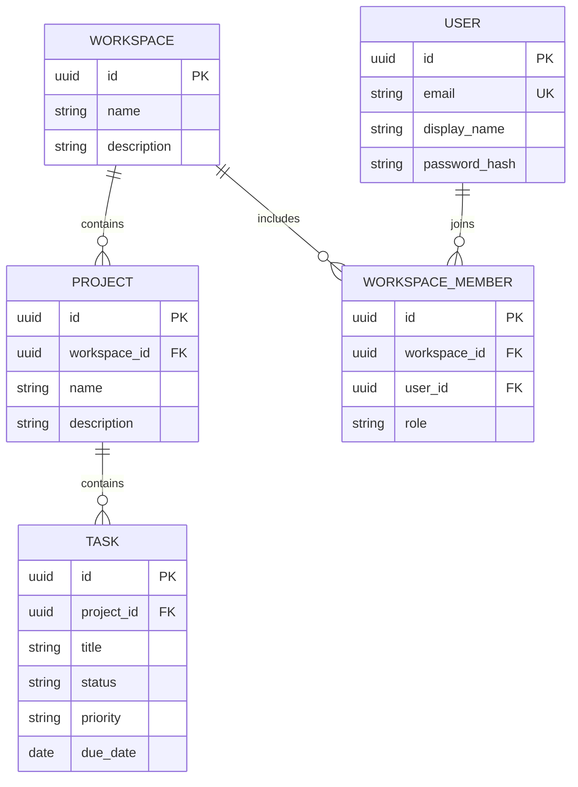

# Архитектура TeamFlow

Приложение — один Spring Boot монолит с пакетами по предметным областям.
Внутри каждой области есть REST controller, DTO, service, JPA entity и repository.



Все сущности также имеют `created_at`, `updated_at`, `version`.
UUID генерирует Hibernate. Даты создаются приложением и хранятся как `TIMESTAMPTZ`.

## Границы ответственности

- Controller: HTTP, валидация DTO и параметров, статус ответа и `Location`.
- Service: проверки связей, транзакции и преобразование сущностей в DTO.
- Repository: запросы к PostgreSQL. Коллекции возвращаются постранично.
- Flyway: единственный источник изменений схемы. Применённые миграции не редактируются;
  для следующего изменения добавляется `V2__...sql`.

Связи `ManyToOne` загружаются лениво. Коллекции обратных связей пока не нужны.
`open-in-view=false`: контроллеры работают с DTO, загрузка данных происходит в сервисных транзакциях.
Удаления подчинённых записей выполняет PostgreSQL через внешние ключи, а не циклы на Java.
Принудительный `flush` перед ответом на запись позволяет вернуть актуальные timestamps.

## Принадлежность и безопасность

Вся иерархия присутствует в URL. Поиск проекта выполняется по `id + workspaceId`,
поиск задачи — по `id + projectId`, предварительно проверяется проект в рабочем пространстве.
Так нельзя прочитать или изменить задачу через URL другого проекта.

Spring Security Resource Server проверяет JWT Bearer: подпись HS256, issuer `teamflow`,
audience `teamflow-api`, UUID subject и срок действия. `NimbusJwtEncoder` выдаёт токены на 30 минут.
Ключ берётся из `JWT_SECRET`; без ключа достаточной длины приложение не запускается.
BCrypt с cost 12 хранит только хеши паролей. `DaoAuthenticationProvider` проверяет вход
и возвращает одинаковую ошибку для неизвестного email и неправильного пароля.

`WorkspaceAccess` проверяет членство и роль в сервисном слое. `ProjectService.requireProject`
проверяет workspace перед поиском проекта; все операции задач используют этот метод.
Список workspace ограничивается членством SQL-запросом до пагинации.
Чужие данные дают `404`, недостаточная роль участника своей команды — `403`.

`workspace_members` имеет уникальную пару workspace/user. Роли `ADMIN` и `MEMBER`
действуют только внутри workspace и не записываются в JWT. Создание workspace и членства
создателя с ролью `ADMIN` выполняется в одной транзакции.
ADMIN управляет workspace, проектами и участниками; MEMBER читает проекты и работает с задачами.
Удаление пользователя на уровне БД также лишает его токен доступа к данным API.

Управление участниками использует `PESSIMISTIC_WRITE` на строке workspace **до** проверки роли
вызывающего пользователя. Удаление и понижение последнего администратора запрещено.
Одинаковая блокировка для всех изменений членства исключает ситуацию, когда два запроса
одновременно удаляют/понижают двух последних администраторов. В интеграционных тестах
проверяется именно одновременный запуск двух запросов.

CSRF отключён для API, который принимает токен только в Authorization header;
сессии, HTTP Basic и form login отключены. `/auth/register`, `/auth/login`, health и документация
доступны без токена. Auth-ответы запрещают кеширование. CORS-доступ для отдельного frontend пока не настроен.
Refresh token, отзыв отдельного JWT, восстановление пароля, подтверждение email и ограничения
частоты входа ещё не реализованы. Для публикации сервиса также понадобится HTTPS.

## Перенос данных из этапа 1

`V2` сохраняет прежние данные. Существующие workspace не получают владельца автоматически:
первый зарегистрировавшийся пользователь не должен присваивать чужие команды.
Владелец БД может вручную привязать известный workspace к проверенному зарегистрированному пользователю.
Сначала найди и проверь их UUID, затем подставь в запрос:

```sql
INSERT INTO workspace_members (id, workspace_id, user_id, role, created_at, updated_at, version)
VALUES (gen_random_uuid(), '<workspace UUID>'::uuid, '<user UUID>'::uuid, 'ADMIN', now(), now(), 0);
```

Публичного API для присвоения команд без владельца нет. Для пустой базы ручные действия не нужны.

## Конкурентность

`@Version` защищает от одновременного изменения одной сущности в пересекающихся транзакциях.
Это ещё не защита от сохранения старой формы спустя несколько минут: для неё позднее можно
добавить версию в DTO или `ETag`/`If-Match`.

## Публикация изменений

Завершённые крупные изменения проверяются тестами, фиксируются отдельным понятным коммитом
и отправляются в GitHub. `.env`, локальные инструменты, логи и `target/` в репозиторий не попадают.
