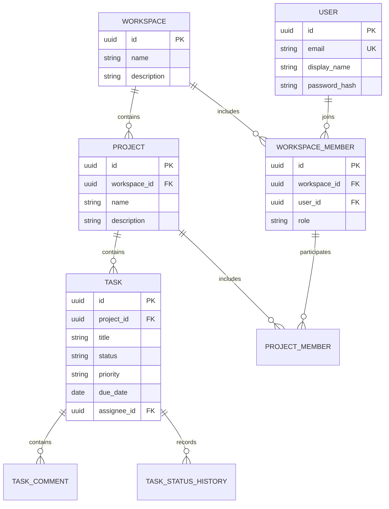

# Архитектура TeamFlow

Приложение — один Spring Boot монолит с пакетами по предметным областям.
Внутри каждой области есть REST controller, DTO, service, JPA entity и repository.



Все сущности также имеют `created_at`, `updated_at`, `version`.
UUID генерирует Hibernate. Даты создаются приложением и хранятся как `TIMESTAMPTZ`.

## Границы ответственности

- Controller: HTTP, валидация DTO и параметров, статус ответа и `Location`.
- Service: проверки связей, транзакции и преобразование сущностей в DTO.
- Repository: запросы к PostgreSQL. Коллекции возвращаются постранично.
- Flyway: единственный источник изменений схемы. Применённые миграции не редактируются;
  следующая версия после `V1`–`V4` — `V5__...sql`.

Связи `ManyToOne` загружаются лениво. Коллекции обратных связей пока не нужны.
`open-in-view=false`: контроллеры работают с DTO, загрузка данных происходит в сервисных транзакциях.
Удаления подчинённых записей выполняет PostgreSQL через внешние ключи, а не циклы на Java.
Принудительный `flush` перед ответом на запись позволяет вернуть актуальные timestamps.

## Принадлежность и безопасность

Вся иерархия присутствует в URL. Поиск проекта выполняется по `id + workspaceId`,
поиск задачи — по `id + projectId`, предварительно проверяется проект в рабочем пространстве.
Так нельзя прочитать или изменить задачу через URL другого проекта.

Spring Security Resource Server проверяет JWT Bearer: подпись HS256, issuer `teamflow`,
audience `teamflow-api`, UUID subject и срок действия. `NimbusJwtEncoder` выдаёт токены на 30 минут.
Ключ берётся из `JWT_SECRET`; без ключа достаточной длины приложение не запускается.
BCrypt с cost 12 хранит только хеши паролей. `DaoAuthenticationProvider` проверяет вход
и возвращает одинаковую ошибку для неизвестного email и неправильного пароля.

`WorkspaceAccess` проверяет членство и роль в сервисном слое. `ProjectService.requireProject`
проверяет workspace и отдельное членство в проекте для MEMBER; ADMIN workspace имеет доступ ко всем его проектам.
Все операции задач, комментариев и истории используют эту проверку.
Списки workspace и проектов ограничиваются членством SQL-запросом до пагинации.
Чужие данные дают `404`, недостаточная роль участника своей команды — `403`.

`workspace_members` имеет уникальную пару workspace/user. Роли `ADMIN` и `MEMBER`
действуют только внутри workspace и не записываются в JWT. Создание workspace и членства
создателя с ролью `ADMIN` выполняется в одной транзакции.
ADMIN управляет workspace, проектами и участниками; MEMBER работает с задачами только в своих проектах.
Удаление пользователя на уровне БД также лишает его токен доступа к данным API.

Управление участниками использует `PESSIMISTIC_WRITE` на строке workspace **до** проверки роли
вызывающего пользователя. Удаление и понижение последнего администратора запрещено.
Одинаковая блокировка для всех изменений членства исключает ситуацию, когда два запроса
одновременно удаляют/понижают двух последних администраторов. В интеграционных тестах
проверяется именно одновременный запуск двух запросов.

CSRF отключён для API, который принимает токен только в Authorization header;
сессии, HTTP Basic и form login отключены. `/auth/register`, `/auth/login`, health и документация
доступны без токена. Auth-ответы запрещают кеширование. CORS-доступ для отдельного frontend пока не настроен.
Refresh token, отзыв отдельного JWT, восстановление пароля, подтверждение email и ограничения
частоты входа ещё не реализованы. Для публикации сервиса также понадобится HTTPS.

## Участники проектов и назначение задач

Создатель проекта получает запись `project_members`. Участников проекта добавляет и удаляет ADMIN workspace.
Состав проекта ограничен участниками того же workspace. Это обеспечивается не только сервисом:
составной внешний ключ `(workspace_id, user_id)` ссылается на `workspace_members`,
а `(project_id, workspace_id)` — на `projects`. Удаление членства в workspace каскадно удаляет его проектные членства.

`tasks(project_id, assignee_id)` ссылается на `project_members(project_id, user_id)`.
При удалении проектного членства PostgreSQL обнуляет только `assignee_id`, сохраняя саму задачу.
Назначение исполнителя и изменения членства берут одну блокировку workspace, чтобы не конфликтовать порядком блокировок.
Даже ADMIN должен входить в состав проекта, чтобы быть назначенным исполнителем.

Автоматическое обнуление исполнителя выполняется БД и обходит Hibernate. Триггер
`trg_task_assignment_version` увеличивает `version` и обновляет `updated_at`, если вызывающая операция
не увеличила версию сама. Обычный JPA update уже меняет версию, поэтому второй раз она не увеличивается.
Это не позволяет старой транзакции восстановить прежнее назначение после удаления и повторного добавления участника.
Синтаксис составного внешнего ключа с выборочным `SET NULL` описан в
[документации PostgreSQL 17](https://www.postgresql.org/docs/17/ddl-constraints.html).

## Комментарии и история статусов

`task_comments` хранит автора, его имя на момент создания, текст и timestamps.
Автор определяется сервером. Редактировать может только автор; удалить — автор или ADMIN workspace.
Перед каждым действием проверяется доступ к проекту и принадлежность комментария задаче.
Удаление участника сохраняет обсуждение. При удалении пользователя `author_id` становится null,
но имя автора и текст сохраняются. Удаление самой задачи удаляет комментарии каскадно.

`task_status_history` хранит from/to status, тип события, автора, его имя и версию задачи.
Создание задачи и запись `CREATED` выполняются в одной транзакции. При изменении статуса
сначала выполняется flush задачи, проверяющий optimistic lock и назначающий новую версию,
затем добавляется `STATUS_CHANGED`. Любая ошибка откатывает обе записи.
Пара `(task_id, task_version)` уникальна и задаёт порядок событий независимо от точности часов.
Изменения других полей и повторное сохранение статуса не добавляют события.
История помечена `@Immutable` и имеет только API чтения; удаление задачи каскадно удаляет историю.

При миграции `V3` прежние участники workspace добавляются в существующие проекты,
чтобы сохранить прежние права. Существующие задачи получают событие `MIGRATED`:
это текущий статус на момент миграции с неизвестным автором, а не восстановленная история прошлых изменений.

## Перенос данных из этапа 1

`V2` сохраняет прежние данные. Существующие workspace не получают владельца автоматически:
первый зарегистрировавшийся пользователь не должен присваивать чужие команды.
Владелец БД может вручную привязать известный workspace к проверенному зарегистрированному пользователю.
Сначала найди и проверь их UUID, затем подставь в запрос:

```sql
INSERT INTO workspace_members (id, workspace_id, user_id, role, created_at, updated_at, version)
VALUES (gen_random_uuid(), '<workspace UUID>'::uuid, '<user UUID>'::uuid, 'ADMIN', now(), now(), 0);
```

Публичного API для присвоения команд без владельца нет. Для пустой базы ручные действия не нужны.

## Конкурентность

`@Version` дополняется обязательным `If-Match` для изменения карточек workspace, проекта, задачи
и комментария. Клиент отправляет ETag, полученный вместе с редактируемыми данными;
устаревшая версия отклоняется с `412`, отсутствие условия — с `428`.

Изменения содержимого проекта, архивирование и операции членства сериализуются блокировкой workspace.
Проверка доступа и версии выполняется после получения блокировки. Это защищает границу
архивирования, но ограничивает параллелизм записи внутри одной команды.

Создание задачи/комментария с Idempotency-Key сохраняет исходный ответ и хеш DTO
в `creation_requests` в той же транзакции. Перед повтором снова проверяется доступ.
Запись сохраняется после удаления самой задачи/комментария и удаляется с проектом или автором.
Подробности и критерии проверки: [надёжность](reliability.md).

## Публикация изменений

Завершённые крупные изменения проверяются тестами, фиксируются отдельным понятным коммитом
и отправляются в GitHub. `.env`, локальные инструменты, логи и `target/` в репозиторий не попадают.
