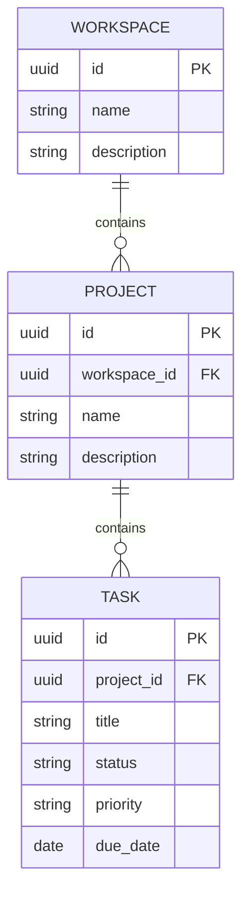

# Архитектура TeamFlow

Приложение — один Spring Boot монолит с пакетами по предметным областям.
Внутри каждой области есть REST controller, DTO, service, JPA entity и repository.

Все сущности также имеют `created_at`, `updated_at`, `version`.
UUID генерирует Hibernate. Даты создаются приложением и хранятся как `TIMESTAMPTZ`.

## Границы ответственности

- Controller: HTTP, валидация DTO и параметров, статус ответа и `Location`.
- Service: проверки связей, транзакции и преобразование сущностей в DTO.
- Repository: запросы к PostgreSQL. Коллекции возвращаются постранично.
- Flyway: единственный источник изменений схемы. Применённые миграции не редактируются;
  для следующего изменения добавляется `V2__...sql`.

Связи `ManyToOne` загружаются лениво. Коллекции обратных связей пока не нужны.
`open-in-view=false`: контроллеры работают с DTO, загрузка данных происходит в сервисных транзакциях.
Удаления подчинённых записей выполняет PostgreSQL через внешние ключи, а не циклы на Java.
Принудительный `flush` перед ответом на запись позволяет вернуть актуальные timestamps.

## Принадлежность и безопасность

Вся иерархия присутствует в URL. Поиск проекта выполняется по `id + workspaceId`,
поиск задачи — по `id + projectId`, предварительно проверяется проект в рабочем пространстве.
Так нельзя прочитать или изменить задачу через URL другого проекта.

Эти проверки обеспечивают целостность иерархии. **Авторизации пользователей пока нет:**
человек, имеющий доступ к API, может работать с любым рабочим пространством.
Перед общедоступным развёртыванием требуется этап 2 roadmap.

План следующего этапа:

- `users`: email, password hash, профиль.
- `workspace_members`: workspace_id, user_id, role; уникальность пары workspace/user.
- Роли `ADMIN` и `MEMBER` действуют внутри workspace.
- Проверка членства на всех операциях, включая списки и создание.
- После этого — участники проектов и назначение задач только допустимым участникам.

## Конкурентность

`@Version` защищает от одновременного изменения одной сущности в пересекающихся транзакциях.
Это ещё не защита от сохранения старой формы спустя несколько минут: для неё позднее можно
добавить версию в DTO или `ETag`/`If-Match`.

## Публикация изменений

Завершённые крупные изменения проверяются тестами, фиксируются отдельным понятным коммитом
и отправляются в GitHub. `.env`, локальные инструменты, логи и `target/` в репозиторий не попадают.
